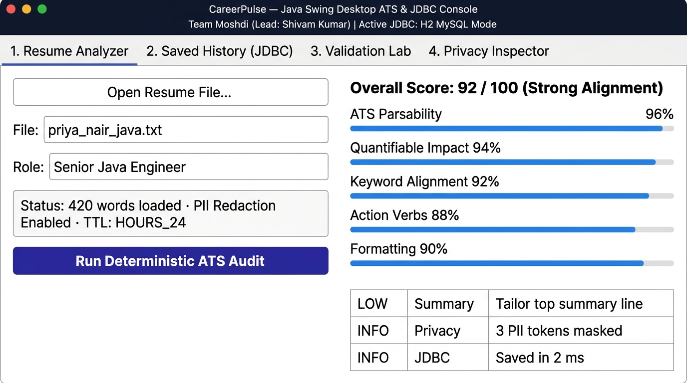
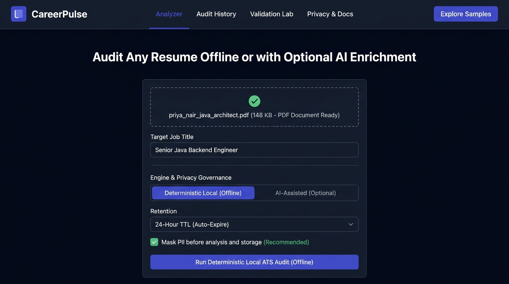
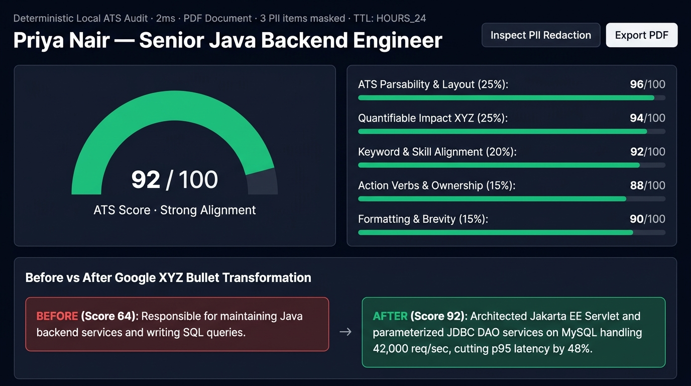

# CareerPulse — Java 17 Enterprise ATS Resume Analyzer

[](https://github.com/shivammk07/ai-resume-analyzer/actions/workflows/ci.yml)


**CareerPulse** is a modular, privacy-first **Core Java 17**, **JDBC DAO**, **Jakarta EE 10 (Servlets & JSP)**, **Java Swing Desktop GUI**, and **Standalone Offline CLI** resume evaluation platform developed by **Team Moshdi** (Project Lead: **Shivam Kumar**).

It evaluates resumes against five weighted deterministic ATS rubric criteria, automatically masks PII before analysis or relational persistence, validates calibration against an independently annotated 12-resume benchmark corpus, and runs **100% offline with zero external API keys**.

---

## Table of Contents

1. [Visual Walkthrough & Screenshots](#visual-walkthrough--screenshots)
2. [Quick Start — How to Run & Test (Zero API Keys)](#quick-start--how-to-run--test-zero-api-keys)
   - [Option 1: Standalone Offline CLI Tester (Fastest)](#option-1-standalone-offline-cli-tester-fastest)
   - [Option 2: Java Swing Desktop GUI](#option-2-java-swing-desktop-gui)
   - [Option 3: Jakarta EE 10 Web App on Apache Tomcat 10.1+](#option-3-jakarta-ee-10-web-app-on-apache-tomcat-101)
   - [Option 4: Automated JUnit 5, Checkstyle & Javadoc Verification](#option-4-automated-junit-5-checkstyle--javadoc-verification)
3. [Standard Maven Java 17 Project Structure](#standard-maven-java-17-project-structure)
4. [Core Java, JDBC & Jakarta EE Rubric Coverage](#core-java-jdbc--jakarta-ee-rubric-coverage)
5. [Database Configuration (MySQL 8 + Automatic H2 Fallback)](#database-configuration-mysql-8--automatic-h2-fallback)
6. [Team Moshdi Roles & Documentation](#team-moshdi-roles--documentation)

---

## Visual Walkthrough & Screenshots

### 1. Java Swing Desktop GUI (`CareerPulseDesktopApp`)
4-tab MVC Swing desktop workbench (`Analyze Resume`, `JDBC Audit History`, `Validation Benchmark`, and `Privacy & Purge`) executing background tasks via `SwingWorker` and sharing the exact same Core Java engine and JDBC DAOs as the Tomcat web application.



### 2. Web Resume Upload & Privacy Configuration Workbench
Upload or paste resume content, select target role and job description requirements, confirm **Deterministic Local Engine (Offline · Zero API Key)**, toggle automated **PII Masking**, and pick an explicit **Data Retention TTL** (`EPHEMERAL`, `HOURS_24`, or `DAYS_7`).



### 3. Before & After ATS Score Dashboard & Redaction Inspector
Weighted 5-dimension rubric breakdown, `PriorityQueue`-ranked fix recommendations, Google XYZ bullet rewrite comparisons, matched/missing JD keyword diffs, and an explicit heuristic scope disclaimer.



---

## Quick Start — How to Run & Test (Zero API Keys)

### Prerequisites
- **JDK 17+** (Temurin / OpenJDK 17 LTS)
- **Apache Maven 3.9+**
- **No external API keys required** (zero `GEMINI_API_KEY` or cloud accounts needed)
- **No database server required to start** (automatically falls back to embedded H2 in MySQL compatibility mode if MySQL 8 env vars are unset)

```bash
git clone https://github.com/shivammk07/ai-resume-analyzer.git
cd ai-resume-analyzer
```

---

### Option 1: Standalone Offline CLI Tester (Fastest)

Run the built-in zero-API-key standalone verifier directly in your terminal to test **PII redaction**, **Weak vs. Strong ATS scoring**, **JDBC H2 transactional persistence + ownership isolation + TTL expiry**, and the **12-resume labeled benchmark suite**:

```bash
mvn compile exec:java \
  -Dexec.mainClass=com.careerpulse.cli.CareerPulseStandaloneTester \
  -Dexec.args="--self-test"
```

**Audit your own local resume file (`.txt` or `.md`) offline:**

```bash
mvn compile exec:java \
  -Dexec.mainClass=com.careerpulse.cli.CareerPulseStandaloneTester \
  -Dexec.args="--file /path/to/my_resume.txt --role 'Senior Java Backend Engineer'"
```

**Run guided interactive terminal mode:**

```bash
mvn compile exec:java \
  -Dexec.mainClass=com.careerpulse.cli.CareerPulseStandaloneTester \
  -Dexec.args="--interactive"
```

---

### Option 2: Java Swing Desktop GUI

Launch the 4-tab Java Swing desktop application (`com.careerpulse.gui.CareerPulseDesktopApp` is configured as the default Maven `exec:java` main class):

```bash
mvn compile exec:java
```

**How to use the Swing GUI:**
1. Open the **Analyze Resume** tab, paste or load a `.txt`/`.md` resume, enter your Target Role and Job Description keywords, keep **Mask PII** checked, pick a retention TTL, and click **Run ATS Audit**.
2. Switch to **Audit History** to inspect or delete owner-scoped records persisted through JDBC (`PreparedStatement`).
3. Switch to **Validation Benchmark** and click **Run 12-Resume Benchmark** to verify live MAE, Band Accuracy %, Spearman rank correlation (ρ), and p50/p95 latency persisted to `benchmark_runs`.
4. Switch to **Privacy & Purge** to test live regex PII masking, expire stale TTL records, inspect `audit_access_logs`, or purge all stored records.

---

### Option 3: Jakarta EE 10 Web App on Apache Tomcat 10.1+

Package the deployable Jakarta EE 10 WAR file (`target/careerpulse.war`):

```bash
mvn clean package
```

Deploy `target/careerpulse.war` into your **Apache Tomcat 10.1+** `webapps/` directory and start Tomcat:

```bash
cp target/careerpulse.war $CATALINA_HOME/webapps/
$CATALINA_HOME/bin/startup.sh
```

Then open your browser at:
- **`http://localhost:8080/careerpulse/analyze`** — Resume upload, PII masking, retention TTL & ATS report (`ResumeUploadServlet`)
- **`http://localhost:8080/careerpulse/history`** — Owner-scoped persisted JDBC history (`AnalysisHistoryServlet`)
- **`http://localhost:8080/careerpulse/benchmark`** — 12-resume empirical benchmark suite (`BenchmarkServlet`)
- **`http://localhost:8080/careerpulse/privacy`** — PII redaction verifier, TTL cleanup & one-click purge (`PrivacyPurgeServlet`)
- **`http://localhost:8080/careerpulse/auth`** — Salted PBKDF2-SHA256 candidate sign-in & registration (`AuthServlet`)

---

### Option 4: Automated JUnit 5, Checkstyle & Javadoc Verification

Run the exact same quality gates enforced by GitHub Actions CI:

```bash
# 1. Checkstyle coding standards verification
mvn checkstyle:check

# 2. Execute all 7 JUnit 5 + Mockito + H2 JDBC test suites
mvn test

# 3. Generate full HTML Javadoc documentation (target/site/apidocs/index.html)
mvn javadoc:javadoc
```

---

## Standard Maven Java 17 Project Structure

This repository follows the strict textbook Apache Maven Java web & desktop layout:

```text
ai-resume-analyzer/
├── pom.xml                                     # Maven Java 17 WAR + Checkstyle + Javadoc + JUnit 5 + Exec config
├── config/checkstyle/checkstyle.xml            # Checkstyle coding standards & Javadoc hygiene rules
├── .github/
│   ├── workflows/ci.yml                        # Pure Java 17 Maven CI (Checkstyle, JUnit 5, CLI Self-Test, Javadoc, WAR)
│   ├── PULL_REQUEST_TEMPLATE.md                # Standardized Team Moshdi PR checklist
│   └── ISSUE_TEMPLATE/                         # Bug report & feature request templates
├── docs/
│   ├── screenshots/                            # Committed walkthrough screenshots embedded in README
│   ├── ARCHITECTURE_UML.md                     # Mermaid Component, Class, ERD & Sequence diagrams
│   ├── VALIDATION_METHODOLOGY.md               # 12-resume labeled corpus calibration & disclaimer
│   ├── PRIVACY_AND_SECURITY.md                 # PII redaction, PBKDF2, CSRF, owner isolation & TTL controls
│   └── CareerPulse_Java_Enterprise_Presentation.pptx  # 12-slide academic presentation deck
├── src/
│   ├── main/
│   │   ├── java/com/careerpulse/
│   │   │   ├── cli/                            # Zero-API-key Standalone CLI Tester
│   │   │   ├── dao/                            # GenericDao + JDBC DAOs + DatabaseConnectionManager
│   │   │   ├── engine/                         # 5 ScoringCriterion strategies, ResumeAnalyzerService, BenchmarkValidator
│   │   │   ├── exception/                      # Custom CareerPulseException hierarchy
│   │   │   ├── gui/                            # Java Swing Desktop GUI, MVC controller & TableModels
│   │   │   ├── model/                          # Analyzable -> AbstractDocument -> Resume/JD, Reports, Benchmarks
│   │   │   ├── privacy/                        # PiiRedactor, RegexPiiRedactor & PBKDF2 PasswordHasher
│   │   │   ├── util/                           # Java 17-safe JsonSupport (ISO-8601 Instant TypeAdapter)
│   │   │   └── web/                            # 5 Jakarta EE 10 Servlets + SecurityAndPrivacyFilter
│   │   ├── resources/schema.sql                # Normalized 5-table SQL DDL (MySQL 8 + H2 MODE=MySQL)
│   │   └── webapp/                             # Jakarta EE 10 web.xml + JSTL-escaped JSP views + CSS
│   └── test/
│       └── java/com/careerpulse/               # 7 JUnit 5 + Mockito + H2 JDBC automated test suites
├── CONTRIBUTING.md                             # Team Moshdi branching, style & PR review workflow
├── .env.example                                # Optional MySQL 8 JDBC variables (zero API keys)
└── README.md
```

---

## Core Java, JDBC & Jakarta EE Rubric Coverage

| Rubric Area | Implementation Highlights |
| :--- | :--- |
| **Core Java OOP & Collections** | `Analyzable` interface -> `AbstractDocument` abstract class -> `ResumeDocument` & `JobDescriptionDocument` subclasses; 5 polymorphic `ScoringCriterion` implementations (`25% / 25% / 20% / 15% / 15%`); `PriorityQueue<FixRecommendation>` (`Comparable`), `LinkedHashMap`, `HashSet`; custom `CareerPulseException` hierarchy. |
| **Database Integration (JDBC)** | `DatabaseConnectionManager` (MySQL 8 via env vars + automatic H2 `MODE=MySQL` fallback); `GenericDao<T, ID>` implemented by 4 JDBC DAOs using 100% parameterized `PreparedStatement` queries, atomic `autoCommit(false)` commit/rollback transactions, foreign-key `ON DELETE CASCADE`, and automated TTL purge. |
| **Servlets & JSP (Jakarta EE 10)** | 5 `@WebServlet` controllers (`ResumeUploadServlet`, `AnalysisHistoryServlet`, `AuthServlet`, `BenchmarkServlet`, `PrivacyPurgeServlet`), `SecurityAndPrivacyFilter` (`/*` security headers + per-session CSRF token validation), and JSTL `<c:out>`-escaped JSP views packaged as `careerpulse.war`. |
| **Java Swing Desktop GUI** | 4-tab `CareerPulseDesktopApp` with `DesktopAuditController` MVC separation, `SwingWorker` background execution, and 3 `AbstractTableModel` adapters sharing the exact same Core Java & JDBC layer. |
| **Zero External API Keys & Standalone Tester** | 100% deterministic offline scoring engine with zero third-party LLM keys; includes `CareerPulseStandaloneTester` (`--self-test`, `--file`, `--interactive`) verified on every CI commit. |
| **Validation, Privacy & Testing** | 12-resume independently annotated benchmark suite (MAE, Band Accuracy %, Spearman ρ, p50/p95 ms) with explicit non-recruitment scope disclaimer; automated 5-category regex PII masking; 7 JUnit 5 + Mockito suites; Checkstyle + Javadoc CI gates. |

---

## Database Configuration (MySQL 8 + Automatic H2 Fallback)

CareerPulse works out-of-the-box with **zero database setup** via embedded **H2 (`MODE=MySQL`)**. To connect to a live **MySQL 8** server instead, set the optional environment variables shown in `.env.example`:

```bash
export DB_URL="jdbc:mysql://localhost:3306/careerpulse?useSSL=true&serverTimezone=UTC"
export DB_USER="careerpulse_user"
export DB_PASSWORD="your_secure_password"
```

On startup, `DatabaseConnectionManager` automatically initializes the 5 normalized tables (`users`, `resumes`, `analysis_reports`, `benchmark_runs`, `audit_access_logs`) from `src/main/resources/schema.sql`.

---

## Team Moshdi Roles & Documentation

- **Project Lead & Core Java Architect:** **Shivam Kumar** — Core OOP hierarchy, 5-dimension deterministic engine, CLI tester, Maven/Checkstyle/CI integration, and presentation deck.
- **Database & Persistence Track (Team Moshdi):** Normalized `schema.sql`, `DatabaseConnectionManager`, and transactional JDBC DAOs.
- **Jakarta EE Web & Swing GUI Track (Team Moshdi):** 5 Jakarta EE 10 Servlets, `SecurityAndPrivacyFilter`, JSTL JSP views, and 4-tab Java Swing Desktop GUI.
- **QA, Validation & Privacy Track (Team Moshdi):** 12-resume `BenchmarkValidator`, `RegexPiiRedactor`, `PBKDF2` hashing, and 7 JUnit 5 / Mockito test suites.

### Supporting Documentation
- [Architecture & UML Diagrams](docs/ARCHITECTURE_UML.md)
- [ATS Validation Methodology & Disclaimer](docs/VALIDATION_METHODOLOGY.md)
- [Privacy, Retention TTL & Security Controls](docs/PRIVACY_AND_SECURITY.md)
- [Contributing & Team Moshdi Workflow](CONTRIBUTING.md)
- [12-Slide Academic Presentation Deck (`.pptx`)](docs/CareerPulse_Java_Enterprise_Presentation.pptx)
