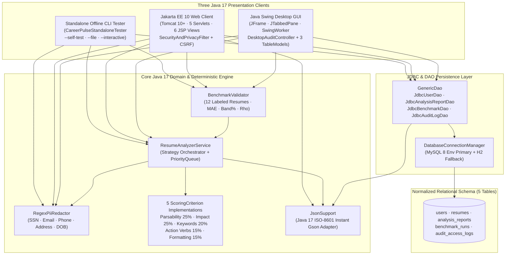
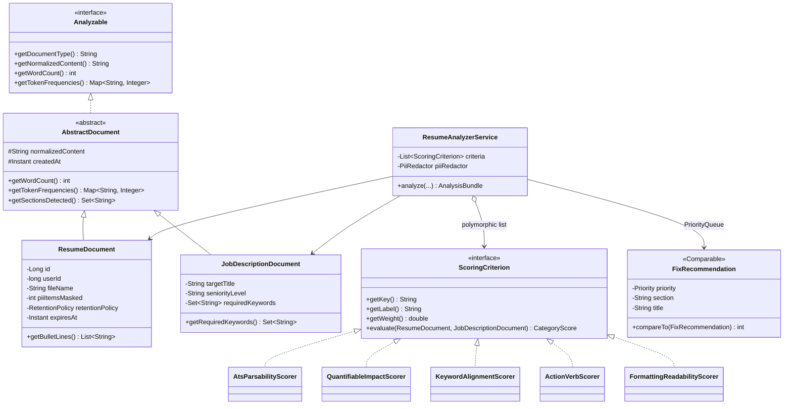
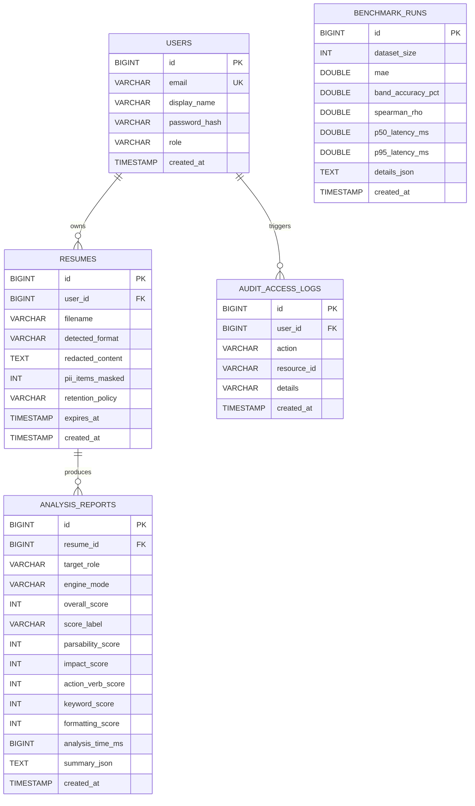
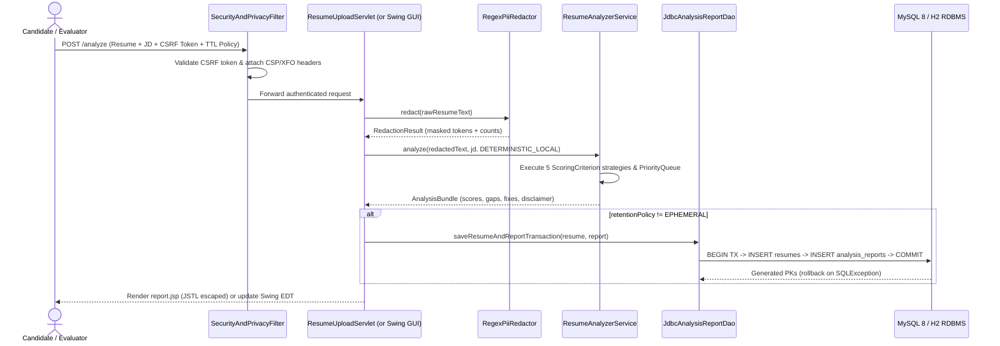

# CareerPulse — Software Architecture & UML Diagrams

**Author:** Team Moshdi (Project Lead: Shivam Kumar)  
**Target Runtime:** Java 17 LTS · Maven 3.9+ · Apache Tomcat 10.1+ (Jakarta EE 10) · MySQL 8 / H2 Fallback

---

## 1. Tri-Client Layered Component Architecture (Zero External API Keys)

The **Standalone Offline CLI Tester**, **Java Swing Desktop GUI**, and **Jakarta EE 10 Web Application (Servlets + JSP)** all share the exact same Core Java 17 domain layer, deterministic scoring engine, PII redaction service, and JDBC DAO layer—eliminating logic duplication and requiring zero external API keys.

---

## 2. Core Java OOP Class Diagram (Interfaces, Inheritance & Polymorphism)

---

## 3. Relational Database Entity-Relationship Diagram (JDBC Schema)

Defined in `src/main/resources/schema.sql` and executed identically on **MySQL 8** and **H2 (`MODE=MySQL`)**:

---

## 4. End-to-End Request & Transaction Sequence Diagram

